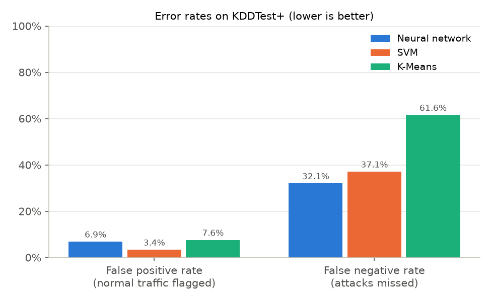
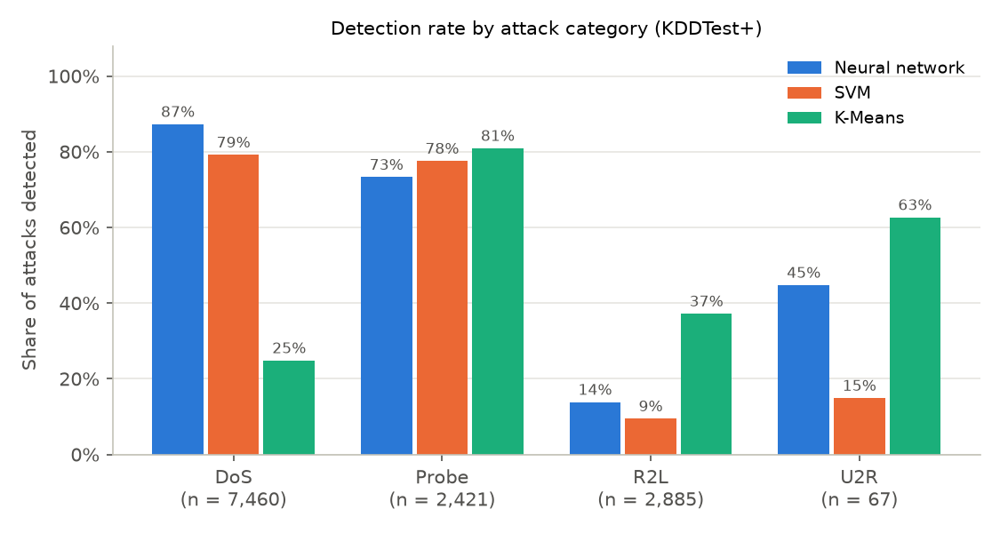
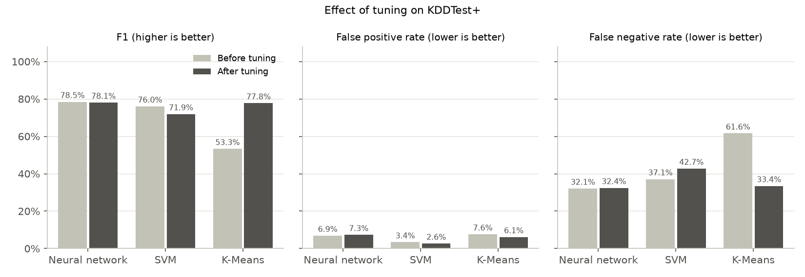
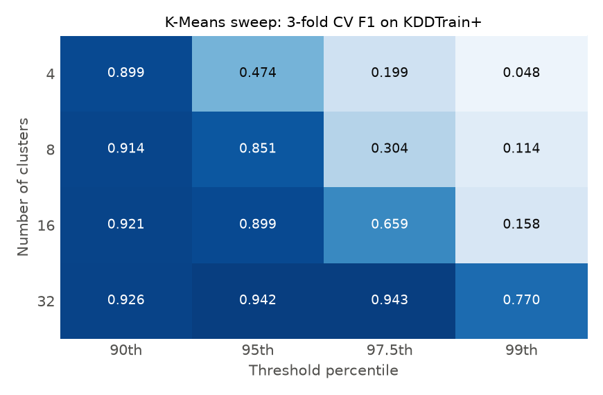

# AI-Based Anomaly Detection for Intrusion Detection Systems

I compare three machine learning approaches for spotting malicious network traffic: a neural network, a support vector machine and a K-Means anomaly detector. I focus on the two errors that matter most to a security operations centre (SOC): false positives (alerts on harmless traffic) and false negatives (attacks that get through). I train and evaluate the models on the public NSL-KDD benchmark, break the results down by attack category, tune each model, and then use the best one to turn records into JSON alerts an analyst could triage. The "live" detection is simulated by replaying records from a file.

## Background

This is a 2026 rebuild of my MSc Cyber Security project at the University of Hertfordshire. The original project used traffic captured from the university network under ethical approval. That data cannot be shared, and the original source code was lost. This rebuild therefore uses a public dataset, NSL-KDD, instead of the university traffic, and I built it with AI coding assistance. I reviewed every part of it and can explain how each piece works and why it was designed that way. [docs/EXPLAINED.md](docs/EXPLAINED.md) is my walkthrough of the code and decisions.

**What this project is not:** it is not deployed, not connected to a production IDS, and not tested on real university or live network traffic. All results come from the NSL-KDD benchmark files.

## Method

| Step | What I did |
|---|---|
| Data | NSL-KDD (Tavallaee et al., 2009): `KDDTrain+` (125,973 records) for training, `KDDTest+` (22,544 records) for testing. 41 features per record. Binary target: 0 = normal, 1 = attack. Each attack name is also mapped to DoS, Probe, R2L or U2R for the breakdown. |
| Preprocessing | One-hot encoding for `protocol_type`, `service` and `flag`; standard scaling for the 38 numeric features. Both live in a scikit-learn `Pipeline` with the model, so the saved file contains the full preparation steps. 41 raw columns become 122 model inputs. |
| Neural network | `MLPClassifier`, supervised, two hidden layers (64, 32), early stopping. |
| SVM | `SVC` with an RBF kernel, supervised, trained on a 20,000-row stratified sample so it runs on a laptop. |
| K-Means detector | Clusters are fitted on **normal training traffic only**. A record is flagged when its distance to the nearest cluster centre exceeds a percentile of the training distances (default: 8 clusters, 95th percentile). |
| Evaluation | Accuracy, precision, recall, F1, false positive rate (FPR) and false negative rate (FNR) on KDDTest+; stratified 5-fold cross-validation on KDDTrain+; detection rate per attack category and for attack types never seen in training. |
| Tuning | Small grid searches chosen by 3-fold cross-validated F1 on the training set only. The test set is used once, to report before and after. |
| Model selection | The model with the highest test-set F1 is saved to `models/best_model.joblib`. |

All random seeds are fixed (42). Re-running `train.py` reproduced the same test metrics exactly.

## Results

Every number below was produced by running the code in this repository. They are recorded in [results/metrics.json](results/metrics.json) and [results/tuning.json](results/tuning.json).

### Baseline models on KDDTest+ (`python train.py --cv`)

| Model | Accuracy | Precision | Recall | F1 | FPR | FNR |
|---|---|---|---|---|---|---|
| Neural network | 0.7878 | 0.9288 | 0.6793 | **0.7847** | 0.0688 | **0.3207** |
| SVM (20k sample) | 0.7742 | **0.9608** | 0.6289 | 0.7602 | **0.0339** | 0.3711 |
| K-Means detector | 0.6167 | 0.8698 | 0.3842 | 0.5329 | 0.0760 | 0.6158 |



### Cross-validation on KDDTrain+ compared with the test set

| Model | 5-fold CV F1 (mean ± std) | Test F1 |
|---|---|---|
| Neural network | 0.9958 ± 0.0007 | 0.7847 |
| SVM | 0.9900 ± 0.0008 | 0.7602 |
| K-Means detector | 0.8243 ± 0.0339 | 0.5329 |

### Detection rate by attack category (baseline models, KDDTest+)

| Model | DoS (n = 7,460) | Probe (n = 2,421) | R2L (n = 2,885) | U2R (n = 67) | Attack types seen in training (n = 9,083) | Attack types **not** seen in training (n = 3,750) |
|---|---|---|---|---|---|---|
| Neural network | **87.3%** | 73.3% | 13.9% | 44.8% | **76.5%** | **47.1%** |
| SVM | 79.2% | 77.6% | 9.5% | 14.9% | 75.7% | 31.8% |
| K-Means detector | 24.9% | **81.0%** | **37.2%** | **62.7%** | 42.3% | 29.1% |



Confusion matrices: [neural network](results/confusion_matrix_neural_network.png), [SVM](results/confusion_matrix_svm.png), [K-Means](results/confusion_matrix_kmeans.png).

### After tuning (`python tune.py`, 441 s)

| Model | Settings chosen by CV F1 | Test F1 before → after | FPR before → after | FNR before → after |
|---|---|---|---|---|
| Neural network | layers (128, 64), alpha 0.001, learning rate 0.01 | 0.7847 → 0.7808 | 0.0688 → 0.0730 | 0.3207 → 0.3242 |
| SVM | C = 10, gamma = 0.1 | 0.7602 → 0.7190 | 0.0339 → 0.0265 | 0.3711 → 0.4275 |
| K-Means detector | 32 clusters, 97.5th percentile | **0.5329 → 0.7775** | 0.0760 → 0.0615 | **0.6158 → 0.3344** |




The saved model is the tuned neural network (highest test F1 after tuning, 0.7808). I did not re-run the per-category breakdown for the tuned models, so those figures are not yet measured.

### Simulated live detection (`python detect.py`)

Replaying all 22,544 KDDTest+ records one at a time through the saved model gave the following ([results/detect_full_summary.txt](results/detect_full_summary.txt)):

| Records | Alerts | True alerts | False alarms | Missed attacks | Time |
|---|---|---|---|---|---|
| 22,544 | 9,382 | 8,673 | 709 | 4,160 | 546 s |

These counts match the tuned neural network's test-set confusion matrix exactly, which confirms that scoring records one at a time gives the same answers as scoring the whole file at once. Example alert output is in [results/detect_demo_output.txt](results/detect_demo_output.txt):

```json
{"timestamp": "2026-11-15T18:57:13+00:00", "record": 1, "verdict": "anomaly", "model": "neural_network", "protocol": "tcp", "service": "private", "flag": "REJ", "src_bytes": 0, "dst_bytes": 0}
```

## Discussion

**Fewest false positives: the SVM.** It flagged 3.39% of normal test traffic before tuning and 2.65% after tuning, the lowest of the three models in both cases. **Fewest false negatives: the neural network.** It missed 32.07% of attacks before tuning. The tuned K-Means detector came close at 33.44%.

This trade-off matters in a SOC. False positives cost analyst time. In a busy network, even a few per cent of normal traffic becomes thousands of alerts, and alert fatigue makes it more likely that a real alert will be ignored. False negatives are attacks that nobody investigates. Neither error can be driven to zero at the same time, so the choice of model, or of the K-Means threshold, is really a choice about which error the organisation can better afford. The K-Means percentile makes that choice explicit. In the sweep, moving from the 90th to the 97.5th percentile at 32 clusters roughly quartered the cross-validated false positive rate (0.0998 → 0.0254) and lowered recall (0.9604 → 0.9175).

Three further findings stand out:

1. **Cross-validation overstates real-world performance.** Every model scored 0.82 to 0.996 F1 in cross-validation but 0.53 to 0.78 on the test set. Cross-validation only contains attack types the model has already seen. KDDTest+ adds 17 new attack types (3,750 records), and R2L makes up 12.8% of the test set but only 0.79% of the training set. Detection of unseen attack types was 29% to 47%, compared with 42% to 77% for attack types seen in training.
2. **Tuning on training data did not transfer for the supervised models.** The settings that won in cross-validation made the neural network and SVM slightly worse on the test set. This is a practical lesson: optimising harder on the known attacks fits the training distribution more closely without helping on new attacks.
3. **The anomaly detector catches what the classifiers miss.** The baseline K-Means detector had the best R2L (37.2%) and U2R (62.7%) detection, the categories where the supervised models were weakest. Tuning made it competitive overall (F1 0.7775). The best setting (32 clusters) is at the edge of the grid I searched, so a larger cluster count might do better still. I have not measured that.

## How to run

Requires Python 3.12. The commands below are for Windows; on macOS or Linux use `source .venv/bin/activate`.

```bash
python -m venv .venv
.venv\Scripts\activate
pip install -r requirements.txt
```

Download the dataset into `data/`. The official page for NSL-KDD (https://www.unb.ca/cic/datasets/nsl.html) states that the dataset is no longer available there. The licence on that page allows mirroring with citation, and I used the public mirror at https://github.com/Jehuty4949/NSL_KDD:

```bash
curl -L -o data/KDDTrain+.txt https://raw.githubusercontent.com/Jehuty4949/NSL_KDD/master/KDDTrain+.txt
curl -L -o data/KDDTest+.txt https://raw.githubusercontent.com/Jehuty4949/NSL_KDD/master/KDDTest+.txt
```

Then run:

```bash
pytest                                    # 56 unit tests
python train.py --cv                      # train, evaluate, charts (about 7 minutes on my machine)
python tune.py                            # grid search and before/after (about 7.5 minutes)
python detect.py --limit 50 --delay 0.1   # simulated live feed with JSON alerts
python detect.py --quiet                  # summary for the whole test file
```

The run times were measured on my Windows machine with 12 logical CPU cores.

## Project structure

```
src/ids/data.py       loading NSL-KDD, column names, attack-category mapping
src/ids/features.py   one-hot encoding + scaling (ColumnTransformer)
src/ids/models.py     MLP and SVM pipelines, KMeansDetector, stratified sampling
src/ids/evaluate.py   metrics, per-category breakdown, charts
train.py              trains and compares the three models, saves the best
tune.py               grid search and before/after comparison
detect.py             simulated live detection, JSON alerts, summary
tests/                pytest unit tests
results/              metrics, tuning results and charts from real runs
docs/EXPLAINED.md     plain-English walkthrough and interview Q&A
```

`data/` and `models/` are not committed. Run the commands above to recreate them.

## Limitations

- **NSL-KDD is an old benchmark.** It is derived from the 1998 DARPA / KDD Cup 99 data, which has known weaknesses (McHugh, 2000). Its traffic does not reflect modern networks, encrypted traffic or current attack techniques, so these results do not predict performance on a real network today.
- **KDDTest+ contains attack types that are not in the training set.** That is why the test scores are much lower than the cross-validation scores. I see this as a realistic test, but the two sets of numbers should not be compared as if they measured the same thing.
- **Detection is simulated from a file.** `detect.py` replays benchmark records; it does not capture packets or read live sensor output. Scoring one record at a time ran at about 41 records per second, far below real network rates. A real deployment would need to score records in batches.
- **The best model is chosen by test-set F1**, as the project brief specified. Choosing on the test set slightly favours the winner. Cross-validation F1 gives the same ranking for the baseline models.
- **Small samples:** the SVM is trained on 20,000 of the 125,973 training rows, and U2R has only 67 test records, so its detection rates are sensitive to a handful of records.
- **The K-Means detector uses labels to select normal traffic for training.** Strictly, that makes it novelty detection rather than fully unsupervised learning.
- **Category mapping:** a few attack names (such as `httptunnel` and `worm`) are assigned to different categories in different papers. My mapping is documented in `src/ids/data.py`.

## Future work

- **Live lab data:** read live Zeek or Suricata logs from a small isolated lab network, map their fields to model features, and score them in near-real time.
- **Modern data:** evaluate on a more recent public dataset with modern traffic.
- **K-Means search:** search larger cluster counts.
- **Better selection:** choose the final model by cross-validation rather than test-set F1.
- **Severity score:** add a score to each alert so analysts can prioritise.

## References

- Tavallaee, M., Bagheri, E., Lu, W. and Ghorbani, A. A. (2009) 'A detailed analysis of the KDD CUP 99 data set', *Proceedings of the 2009 IEEE Symposium on Computational Intelligence for Security and Defense Applications (CISDA)*.
- McHugh, J. (2000) 'Testing intrusion detection systems: a critique of the 1998 and 1999 DARPA intrusion detection system evaluations as performed by Lincoln Laboratory', *ACM Transactions on Information and System Security*, 3(4), pp. 262–294.
- Pedregosa, F. et al. (2011) 'Scikit-learn: Machine learning in Python', *Journal of Machine Learning Research*, 12, pp. 2825–2830.

## Licence

The code is released under the [MIT licence](LICENSE). NSL-KDD is not included in this repository. It is subject to its own terms, which require citing the dataset and Tavallaee et al. (2009).
